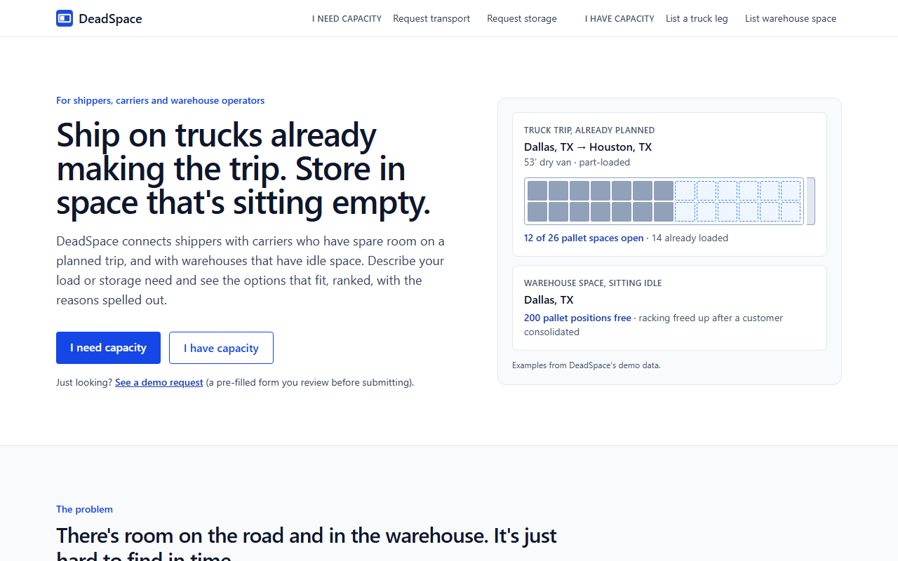
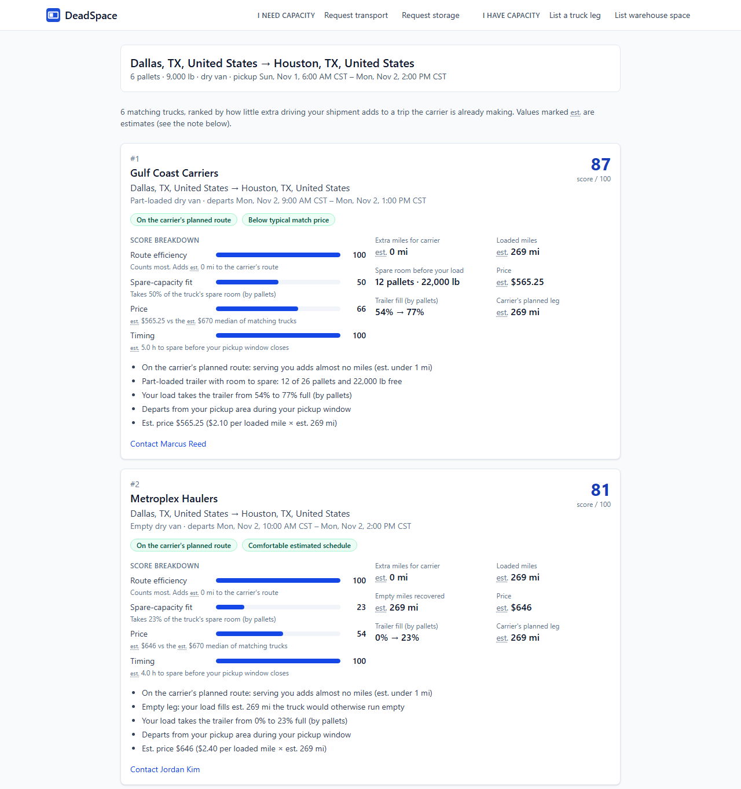
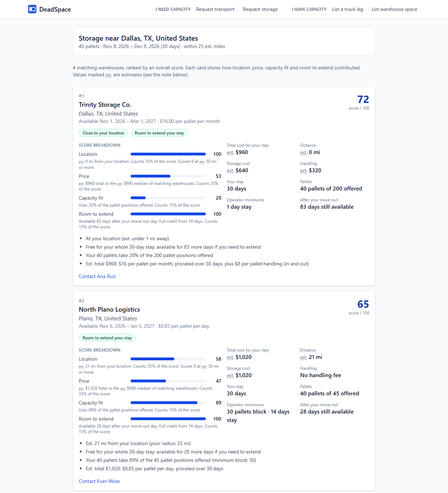
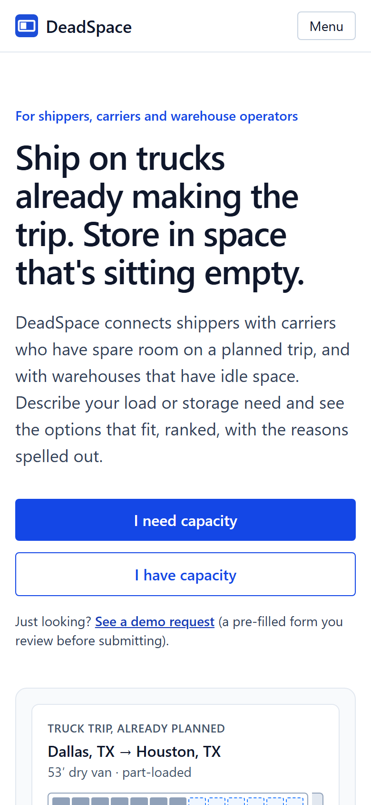
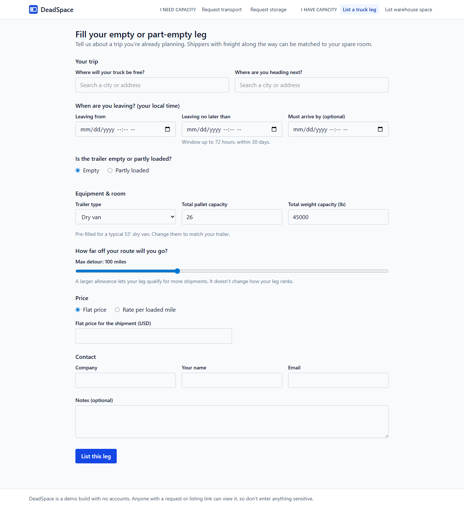
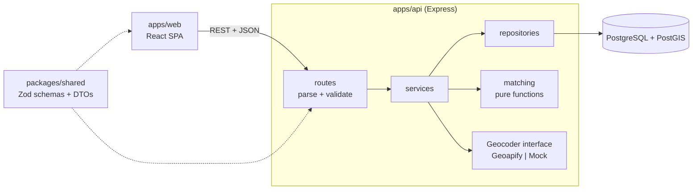

# DeadSpace

**Find spare room on trucks that are already making the trip, and warehouse space that is sitting idle.**

DeadSpace is a B2B marketplace prototype for _stranded logistics capacity_: the empty or part-empty space on a truck leg a carrier is already planning, and warehouse space that is genuinely idle. A shipper describes a transport or storage need and gets back a short list of options that fit, ranked, with the reasons spelled out.

> **Status: V1 demo build.** It runs locally and has no accounts, bookings or payments. See [Limitations](#limitations).



## The problem

Trucks often drive part of a planned trip empty or part-loaded: a return leg, a repositioning move, the room left after a partial load. Warehouses have pallet positions that sit unused between customers. That spare capacity is specific (this trip, these dates, this site) and short-lived, so a shipper who needs it can rarely find it in time, and the owner has little way to offer it.

DeadSpace is built around that specificity:

- It is **not a generic load board**. Every truck listing is one planned movement with an origin, a destination and a bounded departure window. There is no "truck available anywhere" post.
- Warehouse listings describe idle capacity: how many pallet positions, for which dates, with what minimum stay and what pricing.

## How it works

The product has two sides:

|                     | **I need capacity** (shipper)                                        | **I have capacity** (carrier / operator)                               |
| ------------------- | -------------------------------------------------------------------- | ---------------------------------------------------------------------- |
| **Trucks**          | Request transport: pickup, drop-off, window, trailer type, load size | List a truck leg: planned origin to destination, window, spare room    |
| **Warehouse space** | Request storage: location, radius, pallets, dates, required features | List warehouse space: location, pallets, availability, price, minimums |
| **What you get**    | A ranked list of matches with a score breakdown and reasons          | A confirmation page showing the listing as stored                      |

Matches are computed on demand when a request is viewed. Nothing is stored as a "match", and there is no booking step: each card shows a contact link.



## Explainable matching

The matching engine is plain, deterministic code: **no machine learning, no AI**. The same inputs always give the same ranking, and every result carries the numbers and sentences that explain it.

1. **Feasibility first.** Hard constraints remove anything that cannot work: wrong trailer type, not enough spare room, a pickup window the truck cannot reach, a detour beyond the carrier's stated limit, a warehouse outside the radius or not covering the requested dates, missing required features, and so on. Only feasible matches are ranked.
2. **Then ranking.** Each feasible match gets a 0-100 score from weighted components, shown as a breakdown on the card.

Default weights (from [`apps/api/src/matching/config.ts`](apps/api/src/matching/config.ts)):

| Truck leg match                 | Weight | Warehouse match | Weight |
| ------------------------------- | ------ | --------------- | ------ |
| **Route efficiency** (dominant) | 0.55   | Location        | 0.35   |
| Spare-capacity fit              | 0.15   | Price           | 0.35   |
| Price                           | 0.15   | Capacity fit    | 0.15   |
| Timing slack                    | 0.15   | Room to extend  | 0.15   |

Route efficiency is how few extra miles the shipment adds to a trip the carrier was already making. These weights and the thresholds around them are **tunable heuristic defaults chosen for V1**, not optimised or empirically derived values.



### Estimates are estimates

DeadSpace does not call a routing service. Distances come from PostGIS straight-line (geodesic) measurements multiplied by a road factor of 1.2; drive times assume a flat 50 mph; storage costs are prorated by day. Every such figure is labelled **"est."** in the UI and API (`est*` field names). They are for comparing options, not for quoting a route or an invoice.

## Screenshots

| Landing page (mobile)                                                                                  | Carrier truck-leg form                                                                                 |
| ------------------------------------------------------------------------------------------------------ | ------------------------------------------------------------------------------------------------------ |
|  |  |

Screenshots use the seeded demo data only (see [Preparing a demo](#preparing-a-demo)).

## Architecture



- **`packages/shared`** holds the Zod schemas, enums and DTOs used by both the browser and the server, so validation is defined once.
- **`apps/api`** layers routes, services and repositories. PostGIS distances are computed in the database, then passed as plain numbers to the matching module, which has no database, HTTP, clock or randomness dependencies.
- **`apps/web`** is a React single-page app. The landing page is also the explainer: the "need / have" choice and the matching explanation are sections of `/`, not separate routes.

Depth: [`docs/ARCHITECTURE.md`](docs/ARCHITECTURE.md) covers the data model, the full hard-constraint lists, score formulas and the phase history.

### Stack

- **Language / tooling:** TypeScript (strict), npm workspaces, ESLint + Prettier, Vitest, Node 24
- **Frontend:** React 19, Vite, React Router, Tailwind CSS 4, React Hook Form, TanStack Query
- **Backend:** Express 5, Prisma 7 (raw SQL only in the geo repository), Zod 4
- **Database:** PostgreSQL 17 with PostGIS 3.5 (`postgis/postgis:17-3.5`)
- **Geocoding:** Geoapify behind a vendor-neutral interface; a mock geocoder for tests, the seed and offline development
- **CI:** GitHub Actions with a PostGIS service container

## Running locally

Requirements: **Node 24** (see `.nvmrc`) and **Docker** for the database.

```bash
npm install
cp .env.example .env        # defaults work as-is; GEOCODER=mock needs no API key
docker compose up -d        # PostgreSQL 17 + PostGIS on host port 5433
npm run db:migrate          # apply migrations
npm run db:seed             # load the demo data
npm run dev                 # API on :3001, web on :5173
```

Open <http://localhost:5173>.

With `GEOCODER=mock`, location search only knows a fixed list of US cities (mainly in and around Texas). To use Geoapify search, set `GEOCODER=geoapify` and `GEOAPIFY_API_KEY` in `.env`. The seed never calls Geoapify.

Other scripts: `npm run lint`, `npm run typecheck`, `npm run build`, `npm run db:drift`. The image is published for amd64 only, so ARM machines run it under emulation.

## Preparing a demo

The seed dates its data relative to the **next UTC midnight at the moment you seed**, so seeded trips and warehouse windows slide forward each time you run it. A database seeded days ago can return no matches for a fresh request. To get reliable results:

1. Start the database: `docker compose up -d`
2. Migrate: `npm run db:migrate`
3. **Re-seed on demo day:** `npm run db:seed`. It is idempotent: it upserts fixed demo records and does not touch rows created through the app.
4. Start the app: `npm run dev`
5. On the landing page, use **"See a demo request"** or the **"Try it with an example"** links on the "I need capacity" cards. They open the request form pre-filled (Dallas to Houston transport, or Dallas storage). Review it and submit; it is not submitted for you.

The example requests are built from the same anchor calculation the seed uses, and a transport demo window tolerates one UTC midnight passing between seeding and the demo. If more than about a day has passed since seeding, run `npm run db:seed` again. Integration tests check that both example requests return matches against the seeded data.

## Testing

```bash
npm run lint                # ESLint + Prettier check
npm run typecheck
npm test                    # unit tests: shared, api (incl. matching), web
npm run test:integration    # API + PostGIS tests; needs `docker compose up -d`
npm run db:drift            # Prisma schema vs. the migrated database
npm run build
```

At the time of writing there are about 400 unit tests and about 60 integration tests. The matching functions are unit-tested directly; the integration suite runs the HTTP API against a real PostGIS test database (created and migrated automatically), including a seeded Dallas to Houston scenario. CI (`.github/workflows/ci.yml`) runs lint, typecheck, unit tests, build, migrations, the drift check and the integration tests on every pull request.

## Engineering decisions

- **One schema source.** Zod schemas in `packages/shared` validate input on both client and server and define the API types.
- **Pure, deterministic matching.** The matcher takes plain objects with precomputed distances and returns score, breakdown, metrics and human-readable reasons. That makes it easy to unit-test and to explain.
- **Feasibility before ranking.** A match that cannot work is excluded rather than given a low score.
- **Weights in one place.** All weights and thresholds live in `matching/config.ts`, and are described as tunable defaults.
- **PostGIS for geometry, with a drift check.** `*Geog` columns are Postgres generated columns that Prisma cannot model, so the migrations are hand-edited and `npm run db:drift` (also run in CI) fails if the schema and migrations disagree.
- **Vendor-neutral geocoding.** Only `geocoding/geoapify.ts` knows about Geoapify; only label, coordinates and provider name are stored.
- **Explicit domain tables.** `TruckLeg`, `TransportRequest`, `WarehouseSpace` and `StorageRequest` are separate tables rather than one generic "capacity" table.
- **No stored matches.** Matches are computed per request, so they cannot go stale.

## Limitations

This is a V1 demo build. Deliberately out of scope:

- **No authentication or accounts.** Request and listing pages are addressed by hard-to-guess IDs in the URL. That is a demo convenience, **not access control**: anyone with a link can view the record. Do not enter sensitive information.
- **No booking, payments or messaging.** Matches show a contact link only.
- **No routing or live maps.** Distances and drive times are straight-line estimates (see above).
- **Trucks and warehouses only.** No containers or intermodal, and no multi-stop routes or load consolidation.
- **Single-leg matching.** A request is matched to one truck leg at a time.
- **Heuristic scoring.** Weights are untested defaults, not tuned against real shipment data.
- **Seeded, fictional data.** All companies and contacts in the demo data are made up.
- **Not deployed.** Hosting is not set up yet; run it locally.

Known follow-ups are tracked in [`docs/TODO.md`](docs/TODO.md).
