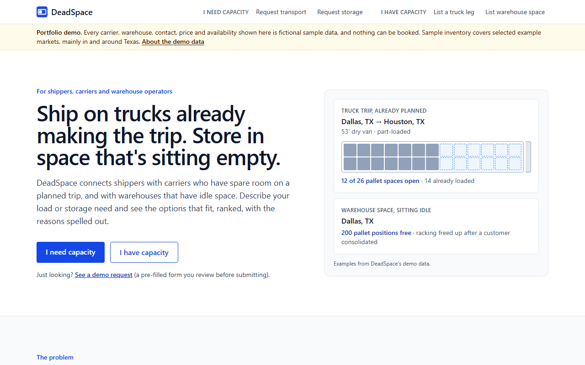
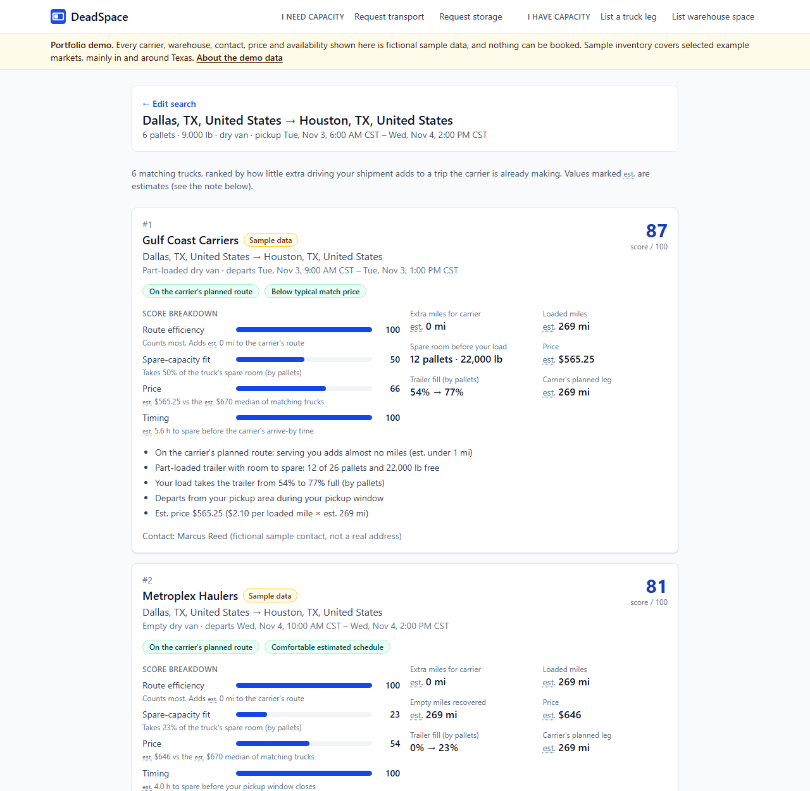
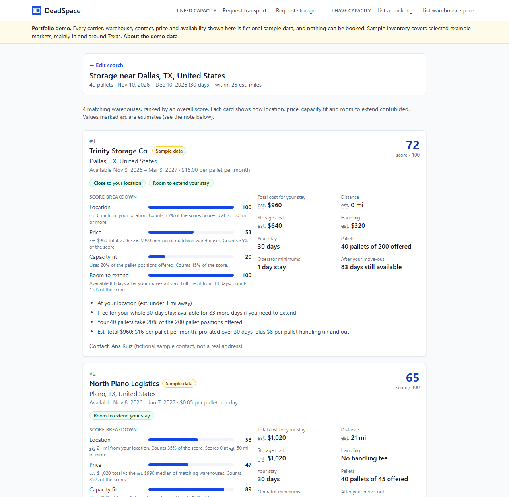
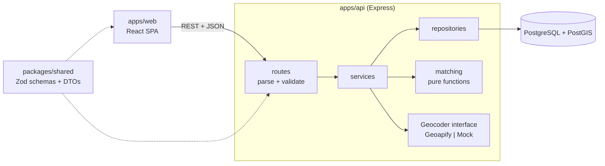
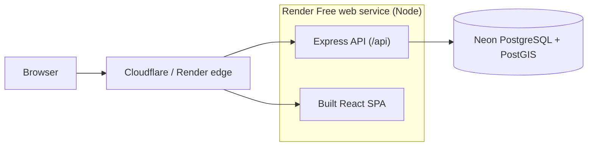

# DeadSpace

[](https://github.com/Chizzy1927/Deadspace/actions/workflows/ci.yml)
[](https://deadspace.onrender.com/)

**Find spare room on trucks that are already making the trip, and warehouse space that is sitting idle.**

DeadSpace is a B2B marketplace prototype for _stranded logistics capacity_: the empty or part-empty space on a truck leg a carrier is already planning, and warehouse space that is genuinely idle. A shipper describes a transport or storage need and gets back a short list of options that fit, ranked, with the reasons spelled out.

## Live demo

### [deadspace.onrender.com](https://deadspace.onrender.com/)



**Try it (about 30 seconds):**

1. Open the demo and click **"See a demo request"** under the main buttons (or **"Try it with an example"** on the "I need capacity" cards).
2. The request form opens pre-filled (Dallas to Houston transport, or Dallas storage). Review it and submit.
3. Read the ranked matches: score, per-factor breakdown, estimated metrics and plain-language reasons.

> **About the demo.** Every carrier, warehouse, contact and price is **fictional sample data**. There are no real carriers, warehouses, bookings, customers or transactions. Public truck and warehouse listing creation is switched off, and those forms say so. It runs on free hosting, so the first load after a quiet period can take about a minute.

## The problem

Trucks often drive part of a planned trip empty or part-loaded: a return leg, a repositioning move, the room left after a partial load. Warehouses have pallet positions that sit unused between customers. That spare capacity is specific (this trip, these dates, this site) and short-lived, so a shipper who needs it can rarely find it in time, and the owner has little way to offer it. DeadSpace is a prototype exploring that gap; established freight and warehousing marketplaces already exist.

It is built around that specificity:

- It is **not a generic load board**. Every truck listing is one planned movement with an origin, a destination and a bounded departure window. There is no "truck available anywhere" post.
- Warehouse listings describe idle capacity: how many pallet positions, for which dates, with what minimum stay and what pricing.

## What you can do

|                     | **I need capacity** (shipper)                                        | **I have capacity** (carrier / operator)                               |
| ------------------- | -------------------------------------------------------------------- | ---------------------------------------------------------------------- |
| **Trucks**          | Request transport: pickup, drop-off, window, trailer type, load size | List a truck leg: planned origin to destination, window, spare room    |
| **Warehouse space** | Request storage: location, radius, pallets, dates, required features | List warehouse space: location, pallets, availability, price, minimums |
| **What you get**    | A ranked list of matches with a score breakdown and reasons          | A confirmation page showing the listing as stored                      |

- **On the public demo:** the request flows work end to end against the sample inventory. The listing forms validate input but store nothing.
- **Run locally:** everything works, including creating listings (see [Run it locally](#run-it-locally)).

Matches are computed on demand when a request is viewed. Nothing is stored as a "match", and there is no booking step.

## Truck and warehouse matching

The matching engine is plain, deterministic code: **no machine learning, no AI**. The same inputs always give the same ranking, and every result carries the numbers and sentences that explain it.

1. **Feasibility first.** Hard constraints remove anything that cannot work: wrong trailer type, not enough spare room, a pickup window the truck cannot reach, a detour beyond the carrier's stated limit, a warehouse outside the radius or not covering the requested dates, missing required features, and so on. A match that cannot work is excluded, not given a low score.
2. **Then ranking.** Each feasible match gets a 0-100 score from weighted components, shown as a breakdown on the card, with estimated metrics (extra miles, empty miles recovered, trailer fill, price) and human-readable reasons.

Default weights (from [`apps/api/src/matching/config.ts`](apps/api/src/matching/config.ts)):

| Truck leg match                 | Weight | Warehouse match | Weight |
| ------------------------------- | ------ | --------------- | ------ |
| **Route efficiency** (dominant) | 0.55   | Location        | 0.35   |
| Spare-capacity fit              | 0.15   | Price           | 0.35   |
| Price                           | 0.15   | Capacity fit    | 0.15   |
| Timing slack                    | 0.15   | Room to extend  | 0.15   |

Route efficiency is how few extra miles the shipment adds to a trip the carrier was already making. These weights and the thresholds around them are **tunable heuristic defaults chosen for V1**, not optimised or empirically derived values.



**Estimates are estimates.** DeadSpace does not call a routing service. Distances are PostGIS straight-line (geodesic) measurements multiplied by a road factor of 1.2, drive times assume a flat 50 mph, and storage costs are prorated by day. Every such figure is labelled **"est."** in the UI and API (`est*` field names). They are for comparing options, not for quoting a route or an invoice.

The matcher is a set of pure functions in `apps/api/src/matching/`: plain objects in (distances precomputed by PostGIS), score, breakdown, metrics and reasons out. It has no database, HTTP, clock or randomness, which keeps it easy to unit-test and to explain. Full constraint lists and score formulas: [`docs/ARCHITECTURE.md`](docs/ARCHITECTURE.md) §5.



## Architecture



- **`packages/shared`** holds the Zod schemas, enums and DTOs used by both the browser and the server, so validation is defined once.
- **`apps/api`** layers routes, services and repositories. Raw SQL lives only in the geo repository.
- **`apps/web`** is a React single-page app. The landing page is also the explainer: the "need / have" choice and the matching explanation are sections of `/`, not separate routes.

More on the data model, endpoints and phase history: [`docs/ARCHITECTURE.md`](docs/ARCHITECTURE.md).

### Production deployment



One Node service serves both the API and the built web app from the same origin, in front of a Neon Postgres database with PostGIS. It runs on free tiers. The public deployment adds rate limiting, write safeguards and proxy-aware client identification, and is covered by CI and a browser-driven smoke test. Details: [`docs/DEPLOYMENT.md`](docs/DEPLOYMENT.md) and [`docs/OPERATIONS.md`](docs/OPERATIONS.md).

## Tech stack

- **Language / tooling:** TypeScript (strict), npm workspaces, ESLint + Prettier, Vitest, Node 24
- **Frontend:** React 19, Vite, React Router, Tailwind CSS 4, React Hook Form, TanStack Query
- **Backend:** Express 5, Prisma 7, Zod 4
- **Database:** PostgreSQL 17 with PostGIS 3.5
- **Geocoding:** Geoapify behind a vendor-neutral interface; a mock geocoder for tests, the seed and the public demo
- **Hosting / CI:** Render, Neon, GitHub Actions (with a PostGIS service container)

## Key engineering decisions

- **One schema source.** Zod schemas in `packages/shared` validate input on both client and server and define the API types.
- **Pure, deterministic matching; feasibility before ranking.** Easy to test and explain. Weights and thresholds live in one config file and are described as tunable defaults.
- **PostGIS for geometry, with a drift check.** `*Geog` columns are Postgres generated columns that Prisma cannot model, so those migrations are hand-edited and `npm run db:drift` (also run in CI) fails if the schema and migrations disagree.
- **Vendor-neutral geocoding.** Only `geocoding/geoapify.ts` knows about Geoapify; only label, coordinates and provider name are stored.
- **Explicit domain tables.** `TruckLeg`, `TransportRequest`, `WarehouseSpace` and `StorageRequest` are separate tables rather than one generic "capacity" table.
- **No stored matches.** Matches are computed per request, so they cannot go stale.

## Testing and verification

| Layer               | What it covers                                                                                                                |
| ------------------- | ----------------------------------------------------------------------------------------------------------------------------- |
| Unit tests          | Shared schemas, the matching functions directly, API and web code (`npm test`)                                                |
| PostGIS integration | The HTTP API against a real PostGIS test database, including a seeded Dallas to Houston scenario (`npm run test:integration`) |
| Static checks       | ESLint + Prettier, strict TypeScript, the production build, and a Prisma schema vs. migrations drift check                    |
| GitHub Actions      | Runs all of the above, plus migrations, on every pull request ([workflow](.github/workflows/ci.yml))                          |
| Production smoke    | A browser-driven check of the deployed site (`npm run smoke:public -- <url>`); see [`docs/DEPLOYMENT.md`](docs/DEPLOYMENT.md) |

Phase 6 deployment verification (November 2026): the public smoke suite passed 53/53 against the production URL. That is a point-in-time deployment result, not a current test count.

## Public-demo limitations

This is a V1 prototype. Deliberately out of scope or limited:

- **Fictional data, no real transactions.** Every company, contact, price and availability is made up.
- **Public listing creation is off.** The truck and warehouse forms validate but store nothing.
- **No authentication or accounts.** Request pages are addressed by hard-to-guess IDs in the URL. That is a demo convenience, **not access control**. Do not enter sensitive information.
- **No booking, payments or messaging.**
- **No routing or live maps.** Distances and drive times are straight-line estimates.
- **Trucks and warehouses only,** matched one truck leg at a time: no containers or intermodal, multi-stop routes or load consolidation.
- **Heuristic scoring.** Weights are untested defaults, not tuned against real shipment data.
- **Limited market coverage.** Sample inventory covers selected example markets, mainly in and around Texas.
- **Free hosting.** Expect a cold start after idle periods.

## Run it locally

Requirements: **Node 24** (see `.nvmrc`) and **Docker** for the database.

```bash
npm install
cp .env.example .env        # defaults work as-is; GEOCODER=mock needs no API key
docker compose up -d        # PostgreSQL 17 + PostGIS on host port 5433
npm run db:migrate          # apply migrations
npm run db:seed             # load the sample data
npm run dev                 # API on :3001, web on :5173
```

Open <http://localhost:5173>. Locally, listing creation is enabled by default. With `GEOCODER=mock`, location search knows a fixed list of US cities (mainly in and around Texas); set `GEOCODER=geoapify` and your own `GEOAPIFY_API_KEY` in `.env` to use live search.

Other scripts: `npm run lint`, `npm run typecheck`, `npm run build`, `npm run db:drift`. Seed horizon and re-seeding: [`docs/OPERATIONS.md`](docs/OPERATIONS.md). The database image is amd64-only, so ARM machines run it under emulation.

## Docs

- [`docs/ARCHITECTURE.md`](docs/ARCHITECTURE.md): data model, endpoints, matching rules, phase history
- [`docs/DEPLOYMENT.md`](docs/DEPLOYMENT.md): production runbook and smoke test
- [`docs/OPERATIONS.md`](docs/OPERATIONS.md): migrations, seeding, recovery
- [`docs/TODO.md`](docs/TODO.md): known follow-ups
